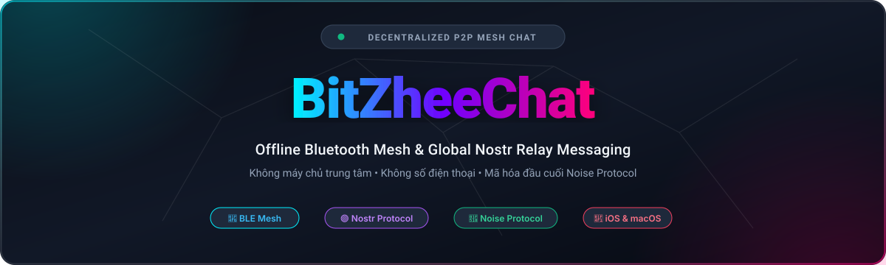

<div align="center">

  

  <br/>

  <p align="center">
    <a href="LICENSE"></a>
    <a href="https://swift.org"></a>
    <a href="https://github.com/zheedevVn"></a>
    
  </p>

  <p align="center">
    <a href="#english"></a>
    &nbsp;&nbsp;
    <a href="#tieng-viet"></a>
  </p>

  <br/>

| 📶 Mạng Lưới Bluetooth Mesh | 🟣 Giao Thức Nostr Toàn Cầu | 🔐 Mã Hóa Noise Protocol | 📴 Hoạt Động Offline |
| :---: | :---: | :---: | :---: |
| Nhắn tin đa bước không cần mạng | Kết nối qua 440+ Relay thế giới | Bảo mật đầu cuối E2EE | Nhắn tin cứu hộ thiên tai |

</div>

---

## 📌 Giới thiệu dự án (About BitZheeChat)

> **BitZheeChat** là ứng dụng nhắn tin ngang hàng (P2P) phi tập trung với kiến trúc truyền tải kép độc đáo: **Mạng lưới Bluetooth Mesh cục bộ** cho phép nhắn tin hoàn toàn offline, và **Giao thức Nostr** cho phép mở rộng kết nối toàn cầu qua Internet.  
> Không cần tạo tài khoản, không cần số điện thoại, không có máy chủ trung tâm nắm giữ dữ liệu.

---

<a id="tieng-viet"></a>
## 🇻🇳 Hướng Dẫn Sử Dụng (Tiếng Việt)

### Tính năng nổi bật

1. **Kiến trúc truyền tải kép (Dual Transport Architecture)**:
   - **Mạng lưới Bluetooth Mesh (Offline)**: Giao tiếp trực tiếp giữa các thiết bị trong phạm vi sóng Bluetooth. Tự động chuyển tiếp tin nhắn qua tối đa 7 bước nhảy (multi-hop mesh), hoàn hảo trong các tình huống mất mạng, thiên tai hoặc vùng sâu vùng xa.
   - **Giao thức Nostr (Online)**: Tự động chuyển tiếp tin nhắn qua hơn 440+ Relay phân tán trên toàn thế giới khi có kết nối Internet.
2. **Kênh chat theo vị trí địa lý (Location-Based Channels)**:
   - Các phòng chat tự động phân vùng theo tọa độ Geohash giúp kết nối cộng đồng xung quanh mà không làm lộ danh tính cá nhân.
3. **Bảo mật & Quyền riêng tư tối đa (Zero-Trust Privacy)**:
   - Mã hóa đầu cuối E2EE bằng **Noise Protocol** cho mạng Mesh và định dạng phong bì bảo mật riêng biệt cho Nostr.
   - Không lưu vết, không tài khoản, cơ chế xóa dữ liệu khẩn cấp (Emergency Wipe) bằng cách chạm 3 lần.
4. **Hỗ trợ đa nền tảng**:
   - Chạy native mượt mà trên cả **iOS** và **macOS**.

---

### Hướng dẫn biên dịch & Chạy mã nguồn

Yêu cầu: **macOS 13+** hoặc công cụ biên dịch Swift 5.9+ (như **XzheeTool**).

```bash
# Clone dự án về máy
git clone https://github.com/zheedevVn/BitZheeChat.git
cd BitZheeChat

# Mở dự án trong Xcode
open BitZheeChat.xcodeproj

# Hoặc biên dịch bằng SwiftPM CLI
swift build
```

---

<a id="english"></a>
## 🌐 Documentation (English)

### Core Features

- **Dual Transport Architecture**: Bluetooth LE mesh for offline P2P + Nostr protocol relays for global internet reach.
- **Decentralized Multi-hop Mesh**: Messages route seamlessly through nearby devices (up to 7 hops) without cellular data or Wi-Fi.
- **End-to-End Encryption**: Built on the [Noise Protocol](https://noiseprotocol.org) framework providing forward secrecy.
- **Zero Identity Metadata**: No phone numbers, no email addresses, no central user registry.
- **Universal Apple Ecosystem Support**: Native SwiftUI application optimized for iOS 16+ and macOS 13+.

---

### Build & Installation

```bash
# Clone the repository
git clone https://github.com/zheedevVn/BitZheeChat.git
cd BitZheeChat

# Open in Xcode
open BitZheeChat.xcodeproj

# Or build via Swift Package Manager
swift build
```

---

## 👨‍💻 Tác giả & Bản quyền / Author & License

- **Tác giả / Author**: **Hồ Đức Minh (zheedevVn)**
- **GitHub Profile**: [@zheedevVn](https://github.com/zheedevVn)
- **Repository**: [https://github.com/zheedevVn/BitZheeChat](https://github.com/zheedevVn/BitZheeChat)
- **Email**: [minhbach251207@gmail.com](mailto:minhbach251207@gmail.com)
- **Giấy phép / License**: Phát hành theo giấy phép [MIT License](LICENSE). Toàn quyền sử dụng, sửa đổi và phân phối.
